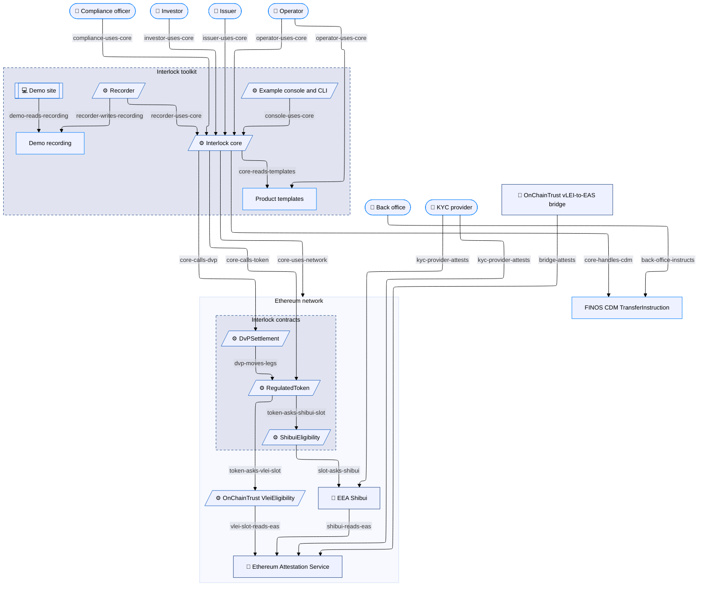
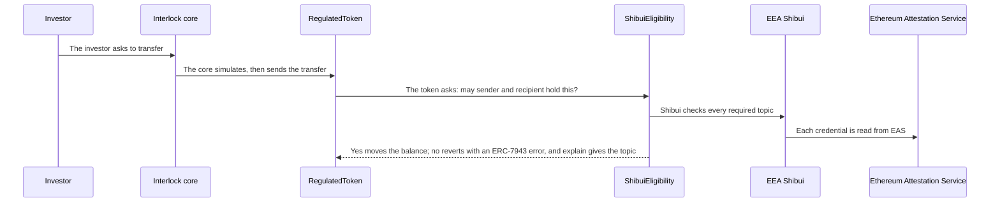
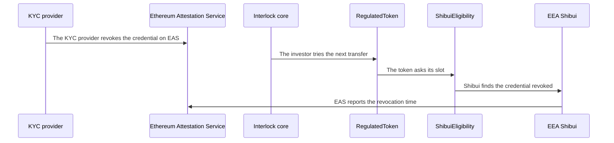
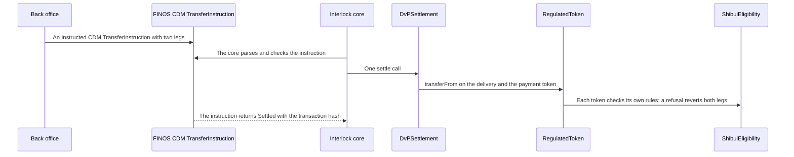
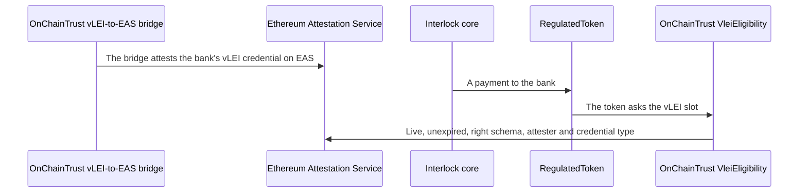

# Interlock architecture (FINOS CALM)

<!-- Generated by `npm run calm:docs` from interlock.architecture.json with the FINOS CALM CLI. Do not edit by hand. -->

This page is generated from [`interlock.architecture.json`](interlock.architecture.json), a model of Interlock in the [FINOS Common Architecture Language Model (CALM)](https://calm.finos.org), release 1.3. CI validates the model in strict mode with the FINOS CALM CLI (`npm run calm:validate`), including every control's configuration against its requirement schema in [`controls/`](controls). If the model and this page disagree, CI fails.

## High level architecture

## Flows

### Transfer checked by eligibility

### Revoke once, blocked everywhere

### Delivery versus payment from a FINOS CDM instruction

### An institution recognised by its vLEI

## Controls

Each control names the decision record behind it and the tests that prove it.

| Where | Control | Decision record | Tests |
|---|---|---|---|
| Ethereum network | **Mainnet refused** (IL-01): The chain id is checked on connect, in deploy and before every signature; chain id 1 is refused before any transaction. | [record](https://github.com/finos-hack/fall-hackathon-2026-beta/blob/main/docs/spec.md) | test/node/c3-mainnet.test.mjs (C3) |
| RegulatedToken | **Fail closed** (IL-02): A reverting, missing or malformed eligibility answer means not eligible; the ERC-7943 views never revert. | [record](https://github.com/finos-hack/fall-hackathon-2026-beta/blob/main/docs/adr/0003-fail-closed.md) | test/unit/RegulatedToken.t.sol (U6); test/integration/FailClosed.t.sol (I8) |
| RegulatedToken | **No product-specific code** (IL-03): Products differ only in their template file; the token has no product logic. | [record](https://github.com/finos-hack/fall-hackathon-2026-beta/blob/main/docs/adr/0006-no-product-specific-solidity.md) | test/node/c2-fourth-template.test.mjs (C2) |
| ShibuiEligibility | **Enforcement separate from explanation** (IL-04): The explanation is a read-only view and can never weaken enforcement. | [record](https://github.com/finos-hack/fall-hackathon-2026-beta/blob/main/docs/adr/0002-enforcement-and-explanation-are-separate.md) | test/integration (I9: explain agrees with isVerified after every state change) |
| DvPSettlement | **Atomic settlement** (IL-05): Both legs or neither; balances conserved; the contract never holds a balance. | [record](https://github.com/finos-hack/fall-hackathon-2026-beta/blob/main/docs/adr/0010-settlement-between-instruments-a-generic-dvp.md) | test/unit/DvPSettlement.t.sol; test/node/settle.test.mjs |
| Interlock core | **Bring your own signer** (IL-06): Institutions sign with their own custody (HSM, MPC, custodian); the core holds no keys. | [record](https://github.com/finos-hack/fall-hackathon-2026-beta/blob/main/docs/adr/0012-core-and-demo-are-separate-bring-your-own-signer.md) | test/node/core.test.mjs |
| FINOS CDM TransferInstruction | **CDM drives settlement and receives the answer** (IL-07): Settlement is driven by a CDM instruction and answered in CDM; CDM does not drive issuance in this round. | [record](https://github.com/finos-hack/fall-hackathon-2026-beta/blob/main/docs/adr/0011-cdm-drives-settlement-and-receives-the-answer.md) | test/node/settle.test.mjs; test/node/record.test.mjs |
| Example console and CLI | **Keys stay on the server side** (IL-08): Keys stay on the server side in the examples; responses never contain a key. | [record](https://github.com/finos-hack/fall-hackathon-2026-beta/blob/main/docs/adr/0007-keys-stay-on-the-server-side-in-the-examples.md) | test/node/server.test.mjs (X3) |

## Building blocks

| Block | Type | What it is |
|---|---|---|
| Interlock toolkit | system | The off-chain part of Interlock: the core library, product templates, example console and CLI, recorder and demo site. |
| Interlock contracts | system | The on-chain part of Interlock: RegulatedToken (one per product), the default ShibuiEligibility slot and DvPSettlement. |
| Ethereum network | network | A local Ethereum node (anvil) by default, or the Sepolia testnet with one setting. Ethereum mainnet is refused. |
| RegulatedToken | service | One ERC-20 contract for every product, with issue, redeem, freeze, forced transfer and pause. Asks its eligibility slot before every balance change. Deployed once per product template. |
| ShibuiEligibility | service | Default eligibility slot. Enforcement is Shibui isVerified, unchanged; explain replays the per-topic check to give a reason such as &quot;accreditation: policy rejected&quot;. |
| OnChainTrust VleiEligibility | service | Second eligibility slot, pinned and unmodified: a wallet is eligible when it holds a live vLEI attestation from the OnChainTrust bridge. |
| EEA Shibui | system | Eligibility layer of the Enterprise Ethereum Alliance, pinned at commit 4414538 and unmodified: per-token verifier, topics registry, trusted attesters and topic policies (KYC, AML, sanctions, country, accreditation). |
| Ethereum Attestation Service | system | Where KYC providers and the vLEI bridge issue and revoke credentials. The real EAS contracts run locally; the public EAS is reused on Sepolia. |
| DvPSettlement | service | Generic delivery-versus-payment contract: both legs move in one transaction or neither does. Never holds tokens, so each token checks the real sender and recipient. |
| OnChainTrust vLEI-to-EAS bridge | system | External bridge that turns GLEIF vLEI credentials into EAS attestations and revokes them when the credential or LEI stops being valid. A local test bridge with fictional banks is used for the recording. |
| Interlock core | service | Node library: deployer, action library and conformance suites. Bring your own signer, or prepare unsigned transactions. No demo cast and no keys. |
| Product templates | data-asset | One JSON file per product (name, symbol, required topics, trusted attesters, country and accreditation rules, eligibility source), validated against schemas/ before any transaction. |
| FINOS CDM TransferInstruction | data-asset | FINOS Common Domain Model 7.10.0 cdm.event.common.TransferInstruction: an Instructed two-leg instruction drives settlement, and comes back Settled with the transaction hash. Every token movement is exported the same way. Validated with the finos-cdm package. |
| Example console and CLI | service | Quickstart server, web console and command-line tool built on the core. Holds the public test keys of the local chain on the server; no key reaches the browser. |
| Recorder | service | examples/record.mjs runs the demo stories through the core against the real contracts and writes the recording; every expected outcome is asserted. |
| Demo recording | data-asset | web/data: every step, result, refusal reason, transaction hash and state, plus the CDM objects. Nothing in it is hand-written. |
| Demo site | webclient | Static page on GitHub Pages that plays the recording back: three products, settlement between instruments, vLEI, and the CDM view. |
| Issuer | actor | A bank, fund manager or private credit firm that issues and redeems its product (fictional in the demo). |
| Compliance officer | actor | Freezes, forces transfers and pauses a product. |
| Investor | actor | Holds and transfers tokens when every product rule is met. |
| KYC provider | actor | Issues one credential per investor, registers it with each product, and revokes it. |
| Operator | actor | Deploys products from templates and authorizes KYC providers, leaving an on-chain audit trail. |
| Back office | actor | Post-trade and operations team that instructs settlement and reads results in FINOS CDM. |
