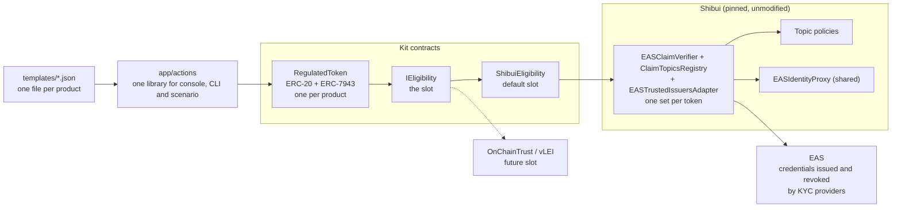

# Architecture

The kit adds three small contracts and reuses everything else as published: Shibui (EEA) at a pinned commit, the Ethereum Attestation Service (EAS) 1.9.0 and OpenZeppelin 5.6.1.

Think of the token as a club and the slot as its door. The club never checks IDs; it asks the door "may this wallet come in?" and gets yes or no. Shibui staffs the door today. Another provider can staff it later through `setEligibility`, without redeploying the token.

## The three kit contracts

| Contract | Job |
|---|---|
| `contracts/RegulatedToken.sol` | ERC-20 with roles, pause, freeze, forced transfer, issue and redeem. Implements ERC-7943 (interface id `0x3edbb4c4`). Asks the slot before every balance change. |
| `contracts/interfaces/IEligibility.sol` | The slot: `isEligible(wallet)` and the read-only `explain(wallet)`. |
| `contracts/ShibuiEligibility.sol` | Default slot. `isEligible` is Shibui's `isVerified`, called so that any failure means "not eligible". `explain` replays the verifier's per-topic check through Shibui's public getters. |

`contracts/EASArtifacts.sol` and `contracts/ShibuiArtifacts.sol` contain only imports. They make Foundry emit artifacts for the pinned EAS and Shibui contracts the deployer needs.

## Token rules

| Action | Role | Rule |
|---|---|---|
| Transfer | Holder | Not paused. Sender eligible. Recipient eligible. Amount within the unfrozen balance |
| Issue | `ISSUER_ROLE` | Not paused. Recipient eligible |
| Redeem | `ISSUER_ROLE` | Not paused. Within the unfrozen balance. Holder eligibility not required, so a lapsed investor can always be paid out |
| Freeze | `COMPLIANCE_ROLE` | Sets the frozen amount (overwrites; may exceed the balance) |
| Forced transfer | `COMPLIANCE_ROLE` | Recipient must be eligible. Works while paused and for an ineligible sender. Unfreezes what it moves, emitting `Frozen` before `Transfer` |
| Pause, unpause | `COMPLIANCE_ROLE` | Stops transfers, issuance and redemption. Forced transfer still works |
| Change the slot, grant roles | Admin | `EligibilityChanged` event |

Refusals use the standard ERC-7943 errors: `ERC7943CannotSend`, `ERC7943CannotReceive` and `ERC7943InsufficientUnfrozenBalance`. The action library then calls `explain` and shows the reason in words, for example "accreditation: policy rejected".

## What is deployed

Shared by all tokens: EAS and its schema registry, the two Shibui schemas (Investor Eligibility; Issuer Authorization, gated by `TrustedIssuerResolver`), one `EASIdentityProxy`, and the KYC, AML, sanctions, source-of-funds, professional and institutional policies. These policies have no settings.

Per token (decision D1): a `ClaimTopicsRegistry`, an `EASTrustedIssuersAdapter`, an `EASClaimVerifier`, a `CountryAllowListPolicy` and an `AccreditationPolicy` if the template needs them, a `ShibuiEligibility` and the `RegulatedToken`. Shibui's verifier reads one topic list, so different rules per token need one verifier per token.

An investor's wallet is their identity: the credential's recipient is the wallet. A KYC provider issues one Investor Eligibility credential on EAS. It then registers a pointer to that credential in each token's verifier, once per required topic. The investor cannot do this themselves; Shibui refuses it.

## Design decisions

| # | Decision |
|---|---|
| D1 | One Shibui verifier, topics registry and trusted-attester list per token. EAS, the identity proxy and the setting-less policies are shared |
| D2 | Enforcement is Shibui's `isVerified`. The explanation is a separate read-only view, so it can never weaken enforcement |
| D3 | Fail closed. A reverting, missing or malformed slot answer means "not eligible", and the ERC-7943 views never revert |
| D4 | The local chain runs the real EAS contracts, not a mock. Who may authorize an attester is enforced the same way locally and on Sepolia |
| D5 | On Sepolia the kit deploys its own Shibui contracts and resolver, and reuses the public EAS |
| D6 | No product-specific Solidity. Products differ only in their template file |
| D7 | Keys stay on the server. The console has an "act as" switch instead of a wallet |
| D8 | Prerequisites are Node 20 and git. Foundry comes from npm (`@foundry-rs/forge`, `@foundry-rs/anvil`) |
| D9 | No upgradeable proxies |
